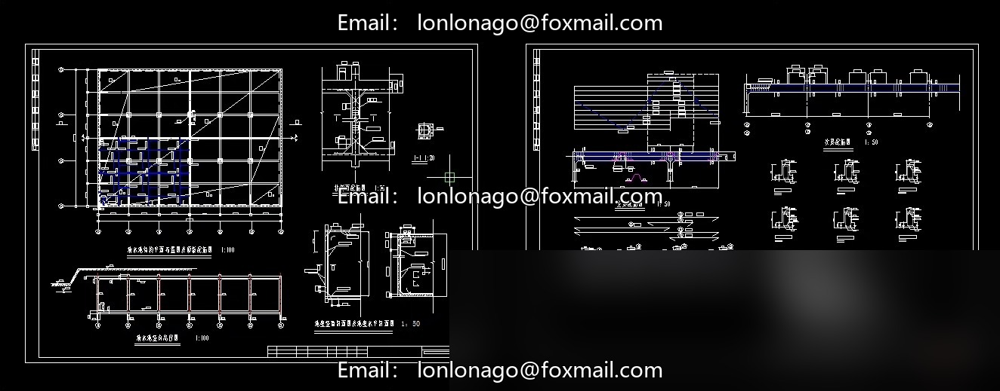
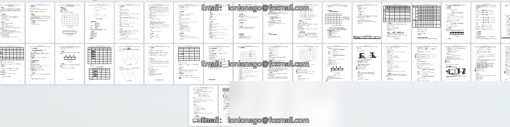
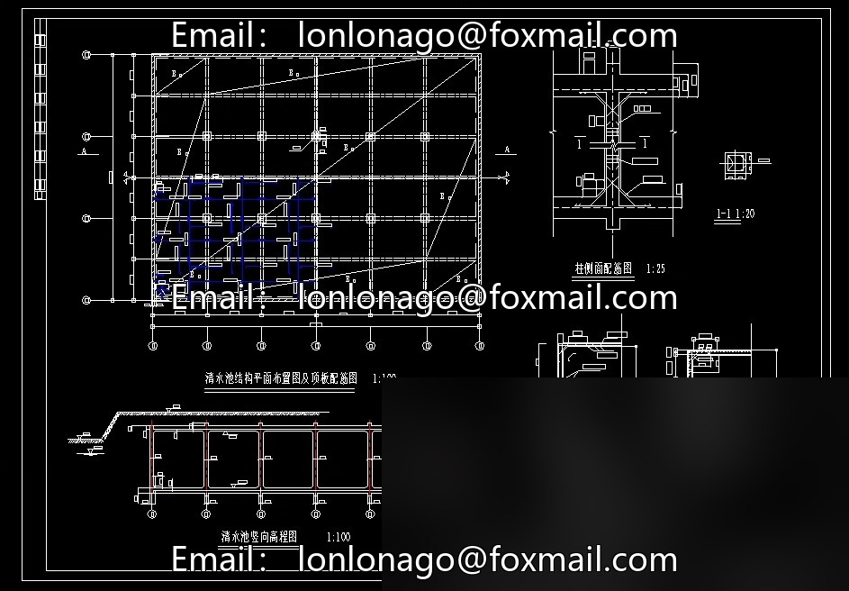
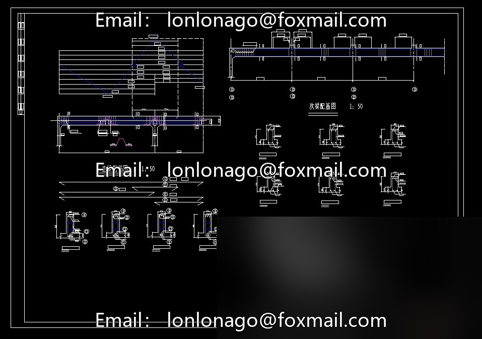

# Concrete retaining pool design; concrete clear water pool design; concrete retaining pool design diagram; concrete retaining pool design drawing

## Body

Concrete reservoir pond design; concrete clear water pool design; concrete reservoir pond design drawing; concrete clear water pool design drawing; concrete reservoir pond CAD drawing; concrete clear water pool CAD drawing
444 This design is for a 1600-ton reinforced concrete clear water pool design, including design descriptions and CAD drawings

The design covers concrete pit design, concrete clean tank design and related CAD figures, including a 1,600-ton reinforced concrete clean tank design with design descriptions and CAD drawings.

<!-- AI_ENRICHED -->

## Images

## Payment

Here is a pay link on Stripe ( https://buy.stripe.com/3cs8yP7sY87d0vu9AB ). Please contact me lonlonago@foxmail.com after funding $89, and I will send you a complete data files , thank you!

